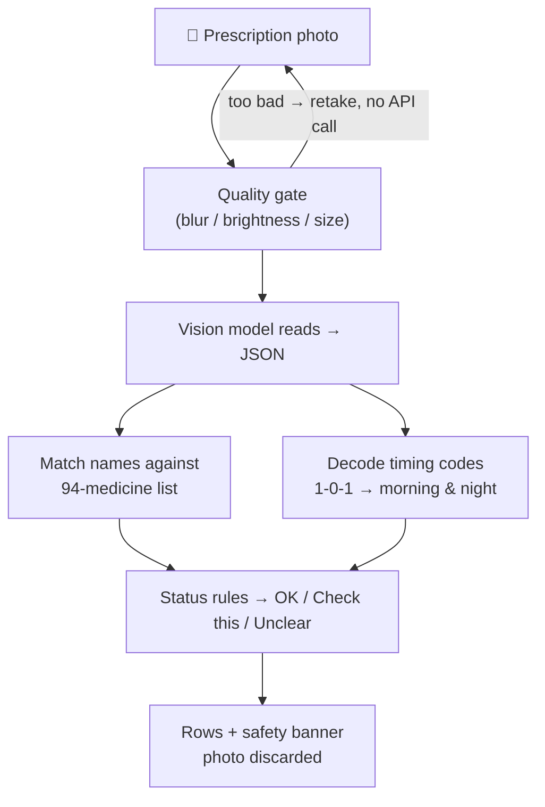

# Trazo

Photograph a doctor's prescription and get back every medicine with its strength, take-times in plain words, and a status word you can trust.

Ask it about a messy paper slip — the kind with `T. SAZO 500 BD`, `1-0-1`, `1/3` scrawled down the margin — and Trazo turns it into a clean table:

> **SAZO 500mg — twice a day (morning & night) — 60 days — ✅ OK**
> **HCQS? — ⚠️ Check this — did you mean HCQS 200?**

---

#### The Problem & Why It Matters?

A doctor writes fast. The patient then holds a paper they cannot decode: abbreviated brands, timing codes like `BD` and `1-0-1`, strengths like `1/3`. Guessing wrong means a skipped medicine or a double dose.

Chatbots will happily *answer* that blurry photo — confidently. That is exactly the wrong behavior for medicine names, where a confident guess is more dangerous than an honest "I couldn't read this."

Trazo flips that: the vision model only reads, and everything the reading touches gets **verified** before it reaches the screen. Every row carries one of three status words:

- **OK** — the name matched the medicine list, the timing code is known, and no near-duplicate brand is confusingly close.
- **Check this** — something didn't verify: "did you mean **Rexazol DSR**?", "two similar medicines — confirm which one", or "no medicine by this name exists in the reference list" (each such name was verified online first).
- **Unclear** — the handwriting beat the model. Shown as unreadable, never filled in.

---

## Features

- **Never guesses.** The core rule, measured: across 38 scored prescription items the app produced **0 confident wrong answers and 0 dropped medicines**. What it couldn't confirm, it flagged. Name accuracy is 0.774 — the rest is flagged, not wrong. Full method in [`eval/RESULTS.md`](eval/RESULTS.md).
- **Plain-words timings.** `1-0-1`, `BD`, `TDS`, `SOS` become "morning & night", "twice a day", "three times a day", "as needed".
- **A real medicine list, not vibes.** Reads are matched against 94 Indian medicines by brand *and* generic name, with fuzzy matching, shorthand prefixes (`HCQ` → HCQS) and ambiguity flags when two real brands sit one letter apart.
- **Honest about the list.** A name that matches nothing is flagged, and if that name was searched online and no medicine exists under it, the row says so explicitly — "verify the spelling on the paper."
- **Photo quality gate.** Too blurry, too dark, or too small? The app asks for a retake *before* spending a model call. The refusal is part of the design.
- **Photo privacy.** Processed in memory, never written to disk, never stored. No accounts, no analytics, no CDNs.
- **A reading aid, always.** Every result carries: *"This is a reading aid, not medical advice. Confirm with your pharmacist."*

---

## How It Works



The model is a ready-made vision model called through an API — nothing was trained. The work is everything around the call: the strict JSON contract, the fuzzy matching with ambiguity flags, the timing decoder, and the status rules that decide what reaches the screen.

---

## Run Locally

```bash
python -m venv .venv
source .venv/Scripts/activate        # Windows; .venv/bin/activate elsewhere
pip install -r requirements.txt
cp .env.example .env                 # paste your NVIDIA_API_KEY
python scripts/load_medicines.py data/medicines_list.csv
uvicorn main:app --reload            # http://127.0.0.1:8000
```

Open the page on your phone and photograph a slip. `scripts/try_one.py` runs one image through the real pipeline from the command line.

---

## Deploy to Vercel

The repo ships serverless-ready: `api/index.py` is the entry point, `vercel.json` routes everything to it, and the read-only medicine database rides in the bundle.

1. Import this repo in the Vercel dashboard (framework preset: **Other**).
2. Add the environment variable `NVIDIA_API_KEY`.
3. Deploy.

On the read-only serverless filesystem the corrections database moves to `/tmp`, and the model timeout is clamped to 55 s under the Hobby plan's 60 s function limit.

---

## Evaluation

One command reproduces the numbers:

```bash
python eval/run_eval.py --mode pipeline            # the full pipeline
python eval/run_eval.py --mode pipeline --final    # adds locked group B, once
```

Real test photos and the answer key never leave the machine (git-ignored). Scoring rules are fixed in [`eval/scoring_rules.md`](eval/scoring_rules.md) before the locked set is touched — the dangerous-error target is **zero**, and it held.

---

## Limits

- Tested on a small set of real prescriptions — a learning project, **not clinically validated**.
- The 94-medicine list bounds what can be confirmed; unknown names are flagged, never invented.
- No dose advice, no interaction checks, no diagnosis. By design.
- Free-tier model API: can be slow or rate-limited under load.
